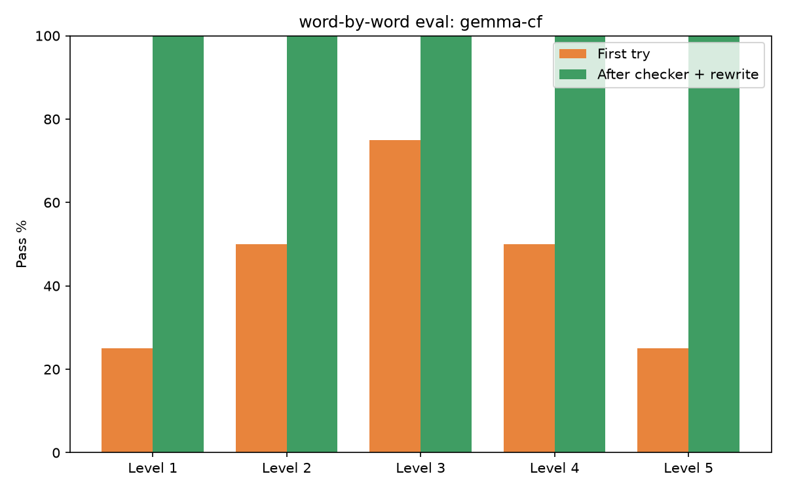
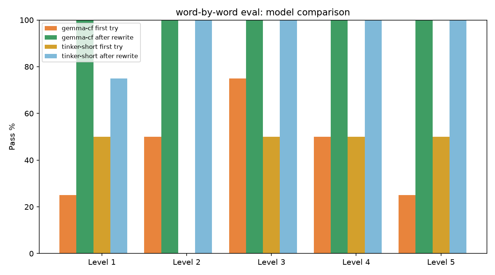

# word-by-word

A FastAPI web app that writes short reading-practice stories for **one child** (age 5-10)
using **only words that child can already read**.

You pick the child's reading level (or use the in-app placement check), and the app asks an
OpenAI-compatible model for a story, then verifies every word against that level's word list.
Words that are too hard or sentences that are too long are sent back to the model for a rewrite
(one rewrite by default, configurable with `MAX_REWRITES`). The child never sees a word the
checker did not approve without a warning.

## How it works

- **Levels** (`app/levels.py`) - cumulative word lists built from `data/levels/*.txt`
  (pre-primer, primer, grade 1-3, Dolch nouns, everyday words), plus the top 1500 English
  words from `wordfreq` at level 5. Each level also has a max sentence length (6-14 words).
- **Checker** (`app/checker.py`) - pure Python, no model. Normalizes curly apostrophes,
  tokenizes, splits sentences, and reports bad words / long sentences / in-list rate.
  Simple inflections (plural, -ed, -ing, -er, doubled consonants, dropped e) are allowed
  from level 2. Possessive `'s` is allowed at every level.
- **LLM** (`app/llm.py`) - works with any OpenAI-compatible API. This build uses
  **Cloudflare Workers AI** with the open model `@cf/google/gemma-4-26b-a4b-it` (Gemma 4,
  Apache 2.0 weights served on Workers AI). Prompts use the placeholder names MINU (child)
  and PIP (pet), so the child's real name never reaches the model; the real names are
  swapped in locally afterwards. If the checker fails the draft, the draft plus a rewrite
  message are sent back at a lower temperature (`MAX_REWRITES` tries, default 1). Thinking
  blocks are stripped from model output. Reading-comprehension questions are generated the
  same way and checked too.
- **Frontend** (`frontend/` - Next.js 16 + TypeScript + Tailwind, runs with npm) - word-bank
  placement, story writing, clickable words, stuck-word tracking, questions, browser
  read-aloud, and a print view. It talks to the API through a same-origin `/api/*` proxy
  (`frontend/next.config.ts`). The backend is API-only: `GET /` returns a JSON status ping.

## Run locally

Two parts run together: the **API** (Python/FastAPI, folder root) and the **frontend**
(Next.js/TypeScript, `frontend/` folder). In two separate terminals:

**Terminal 1 - the API:**

```bash
python -m venv .venv
.venv\Scripts\activate            # Windows  (source .venv/bin/activate on macOS/Linux)
pip install -r requirements.txt
copy .env.example .env            # then edit .env with your model settings
uvicorn app.main:app --reload     # serves http://127.0.0.1:8000
```

**Terminal 2 - the frontend (Next.js):**

```bash
cd frontend
npm install
npm run dev                       -> serves http://localhost:3000
```

Open **http://localhost:3000** - that is the app. It reaches the API through the
`/api/*` proxy in `frontend/next.config.ts`, which reads `BACKEND_URL`
(default `http://127.0.0.1:8000`, so nothing else to configure).

Useful commands:

```bash
.\dev.ps1                                    # ONE command: starts backend + frontend together
.\dev.ps1 -Stop                              # stops both
pytest                                       # run the checker/LLM tests (from the repo root)
.venv\Scripts\python.exe scripts\stress_test.py   # 33-check stress test: endpoints, validation, secret leaks
npm run build                                # production build of the frontend (from frontend/)
python scripts/evaluate.py --label gemma-cf  # checker evaluation + chart (from the repo root)
```

The backend serves no interface: `GET /` and `GET /health` return a small JSON
status (`{"ok": true}`) — the Next.js frontend in `frontend/` is the whole product.

### Configuration (`.env`)

| Key              | Meaning                                          |
| ---------------- | ------------------------------------------------ |
| `LLM_BASE_URL`   | OpenAI-compatible API base URL                   |
| `LLM_MODEL`      | Model name                                       |
| `LLM_API_KEY`    | API key (never logged, never sent to the user)   |
| `LLM_MAX_TOKENS` | Max completion tokens per call (default `1000`)  |
| `MAX_REWRITES`   | Rewrite attempts when the checker fails (default `1`) |
| `PROMPT_STYLE`   | `full` (default) or `short`                      |

Example Cloudflare Workers AI configuration:

```env
LLM_BASE_URL=https://api.cloudflare.com/client/v4/accounts/<ACCOUNT_ID>/ai/v1
LLM_MODEL=@cf/google/gemma-4-26b-a4b-it
LLM_API_KEY=<cloudflare api token>
LLM_MAX_TOKENS=1000
MAX_REWRITES=1
PROMPT_STYLE=full
```

### Privacy

The story model only ever sees the placeholder names **MINU** and **PIP**. The child's real
name (and pet's name) are typed in the browser and swapped in locally after the story is
generated; they are never sent over the wire, never logged, and never appear in the rewrite loop.

**Read aloud** uses the browser's built-in speech synthesis (`SpeechSynthesisUtterance`),
so the audio is generated on the device itself: no audio API, no key, no network call, and
the story - real names included - never leaves the computer. Tapping a single word speaks
just that word the same way.

## Word lists

The shipped lists in `data/levels/` come from the **public-domain Dolch word lists**
(pre-primer, primer, grade 1-3, and the 95 Dolch nouns), plus a small `everyday.txt` list of
common words a 5-10 year old meets outside school. Level 5 additionally includes the top
1500 English words from the [`wordfreq`](https://pypi.org/project/wordfreq/) package, which
is CC-BY-SA data computed from public corpora.

## Tests

```bash
pytest
```

## Evaluation

Runs the last 4 topics in `data/topics.txt` across all 5 levels, saves a CSV and a grouped
bar chart, and prints a summary table:

```bash
python scripts/evaluate.py --label gemma-cf --n-per-level 4
# optional: --base-url, --model, --api-key-env (default LLM_API_KEY), --prompt-style
```

Results land in `results/eval_gemma-cf.csv` and `results/eval_gemma-cf.png`.

The chart compares **first-try passes** with **passes after one rewrite** at each level -
how often the checker approved the story immediately vs. after sending it back once.



Results from the run above (20 stories, `gemma-4-26b-a4b-it`, `PROMPT_STYLE=full`):
first-try pass rates were 25-75% depending on level, but **after one rewrite every level
reached 100%**, and the average in-list rate improved at every level. The checker + one
rewrite reliably produces a story the child can actually read.

## Optional: fine-tuned Tinker model

As an experiment, the app can also run on a **fine-tuned Qwen3.5-4B** trained with
[Tinker](https://tinker.thinkingmachines.dev):

```bash
python scripts/generate_dataset.py --target 100   # build data/train.jsonl
python scripts/train_tinker.py                    # LoRA rank 32, ~50s for 1 epoch
python scripts/evaluate.py --label tinker-short --n-per-level 4 \
    --base-url "$TINKER_BASE_URL" --api-key-env TINKER_API_KEY \
    --model "$(python -c "import json;print(json.load(open('results/tinker_checkpoints/latest.json'))['checkpoint'])")" \
    --prompt-style short
python scripts/compare_chart.py --label gemma-cf --label tinker-short
```

`scripts/train_tinker.py` trains on the 100 generated short-prompt stories (supervised
cross-entropy on the assistant tokens only), then serves the checkpoint through Tinker's
OpenAI-compatible endpoint, so `scripts/evaluate.py` and the app can talk to it unchanged.



On the same 20 stories the fine-tuned model reaches 100% after one rewrite at levels 2-5
(75% at level 1), at ~2s per story with a short prompt. Gemma has the better first-try
quality and the higher in-list rate; the fine-tuned 4B model is cheaper, faster, and was
trained in under a minute - but it needs the checker's rewrite just as much.

## Deploy to Render

The included `render.yaml` defines **two** services:

- `word-by-word` — the FastAPI API (Python, `uvicorn`, health check `/health`)
- `word-by-word-ui` — this Next.js UI (Node, `npm run build && npm run start`)

1. Push this repo to GitHub/GitLab.
2. In Render: **New + > Blueprint**, pick the repo.
3. On the API service set `LLM_BASE_URL`, `LLM_MODEL`, `LLM_API_KEY`, `LLM_MAX_TOKENS`,
   `MAX_REWRITES`, and `PROMPT_STYLE` in the Render **dashboard** (not in the repo) when prompted.
4. After the API deploys, copy its public URL (e.g. `https://word-by-word-xxxx.onrender.com`)
   and paste it as `BACKEND_URL` on the **UI** service, then redeploy the UI.
5. Done: the browser talks only to the UI, and the UI proxies `/api/*` to the API server-side,
   so no CORS configuration is needed. (`CORS_ORIGINS` on the API exists only if you later
   call the API directly from another origin.)

No database, no login, no extra frameworks.
